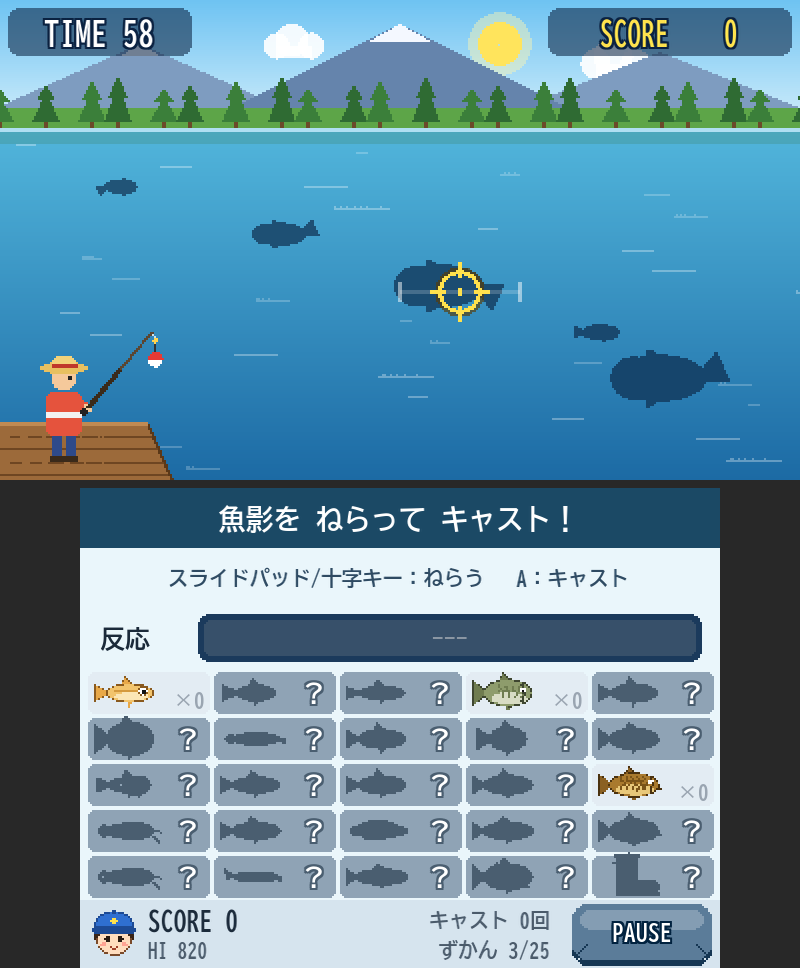
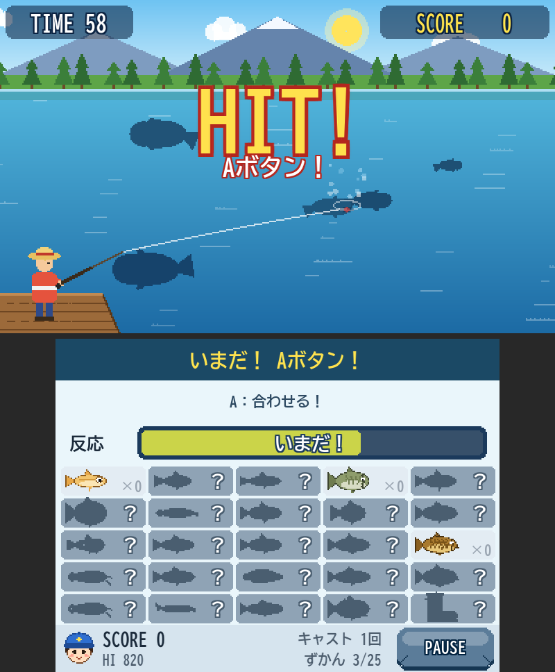
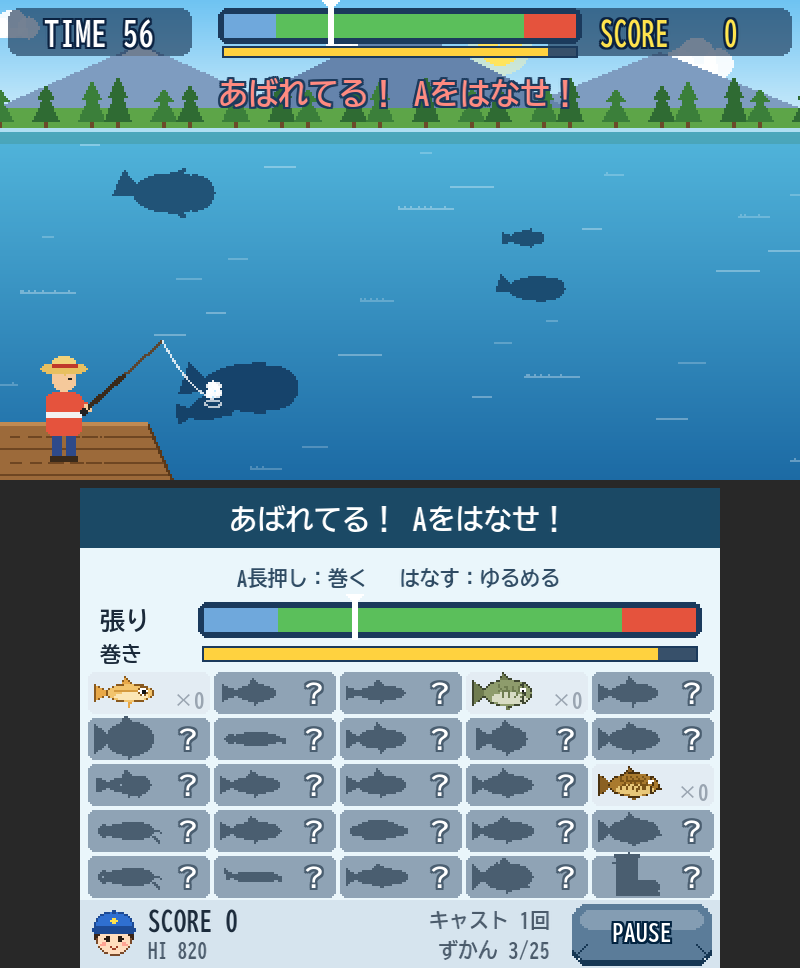
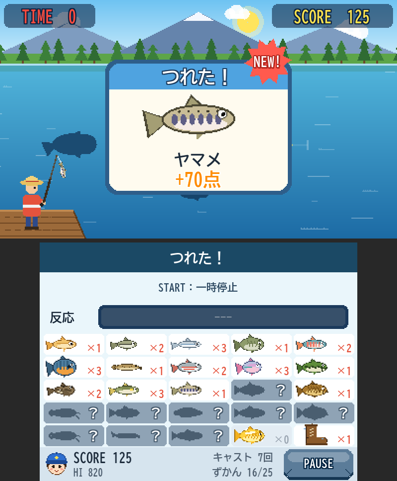

# わくわくフィッシング3DS（Waku Waku Fishing）

初代 Nintendo 3DS 向けの自作 2D 釣りゲームです（Homebrew Launcher で起動する `.3dsx`）。
湖を泳ぐ魚影を見つけて狙った位置にウキを投げ、魚が食いついた瞬間に A ボタンで合わせ、糸の張りを保ちながら巻き上げます。
制限時間 60 秒で、できるだけ高い得点を目指します。

| タイトル | 狙う | HIT! | やりとり | 黄金の魚 | ずかん | 結果 |
|---|---|---|---|---|---|---|
|  |  |  |  |  |  |  |

※ 画像は PC 上のプレビューツール（`tools/preview`）で描画コードを動かして作ったものです。文字は PC のフォントで代用しているため、実機とは字形が少し異なります。

- 言語：C（C99）
- 開発環境：devkitPro / devkitARM、libctru、citro2d / citro3d
- 対象：初代 Nintendo 3DS（New 3DS 専用機能は不使用）、立体視なし、通信なし
- 外部素材なし（絵はすべて図形描画、効果音と BGM はプログラムで合成。曲もオリジナル）

---

## 1. 遊び方

1. タイトル画面の下画面で、あそぶ人の **顔（おとこのこ／おんなのこ）** を **十字キー左右** か **タッチ** でえらび、**A ボタン** または **「スタート」** をタッチ
2. **スライドパッド / 十字キー左右** で黄色い照準（着水予定位置）を動かす
3. 魚影の **少し横**（5〜30px。照準の左右に出る白い目盛りが目安）に合わせて **A** でキャスト
   - 魚影の真上（5px 未満）に落とすと魚は驚いて逃げる
   - 遠すぎる（30px 超）と反応しない
4. 魚がウキに寄ってきて、しばらくすると食いつく（この間に A を押すと「早すぎた！」で失敗）
   - **フェイントに注意**：本物の食いつきの前に、ウキが一瞬だけ沈むことがある。見た目は本物そっくりだが「HIT!」は出ない。ここで A を押すと「フェイントだった！」で失敗
   - フェイントの回数はレアな魚ほど多い（メダカ 0〜1 回 … 黄金の魚 2〜4 回）
5. ウキが沈んで **「HIT!」** が出たら、すぐに **A**！
   - 入力猶予：小 0.85 秒 / 中 0.7 秒 / 大 0.55 秒（下画面の反応ゲージで残り時間が分かる）
6. 合わせに成功すると **「やりとり」**。上画面中央（と下画面）の **テンションメーター** を見ながら釣り上げる
   - **A を押している間** 糸を巻く（張りが強くなり、巻き上げが進む）。**離すと** 張りがゆるむ
   - 張りが赤い所の右端まで行くと **糸が切れる**。青い所で 0 のまま 0.6 秒たつと **針が外れる**
   - 魚の上に **「！」** が出たら暴れる合図。暴れている間は巻けず、巻くと張りが一気に上がるので **A を離す**
   - 黄色いバー（巻き上げ）が満タンになったら釣り上げ成功
7. 60 秒経つと結果画面。ランク（D〜S）と **ハイスコア TOP5**（顔アイコン付き）が表示される

大きな魚影ほど高得点の魚（ニシキゴイ、オオナマズ、黄金の魚…）が期待できますが、合わせはシビアで、やりとりも手ごわくなります。

### やりとりの強さ（レアな魚ほど手ごわい）

魚種は珍しい順に並んでいて、下に行くほど巻き上げが遅く、暴れが強く、「！」から暴れるまでが短くなります（上手な人の目安時間）。

| 魚種 | 暴れ | 予兆（「！」）の長さ | 目安時間 |
|---|---|---|---:|
| メダカ | 暴れない（押しっぱなしで釣れる） | － | 約1秒 |
| モツゴ〜ブルーギル | 弱い | 0.50〜0.45 秒 | 約2秒 |
| ドジョウ〜ヤマメ | ふつう | 0.43〜0.36 秒 | 約2.5〜3.5秒 |
| ニジマス〜ソウギョ | 強い | 0.35〜0.31 秒 | 約4〜6秒 |
| ニシキゴイ〜イトウ | とても強い | 0.30〜0.28 秒 | 約6〜9秒 |
| 黄金の魚 | 激しい・頻繁 | 0.27 秒 | 約10秒 |
| 長靴 | 暴れない（重いだけ） | － | 約2秒 |

やりとり中も制限時間は減るので、大物ほど時間もかかります。

### 操作一覧

| 操作 | 内容 |
|---|---|
| スライドパッド左右 / 十字キー左右 | 着水予定位置の移動／タイトル画面であそぶ人をえらぶ |
| A | 開始・キャスト・合わせ・リトライ |
| A 長押し | やりとり中に糸を巻く（離すとゆるむ） |
| B | 釣り糸を回収（キャンセル）／結果画面でタイトルへ |
| START | 一時停止メニュー（ゲームに戻る／タイトルに戻る／ゲームを終了する） |
| 十字キー上下 | 一時停止メニューの選択 |
| タッチ | あそぶ人の顔・スタート・PAUSE・メニュー・リトライ・タイトルへ |

「ゲームを終了する」を選ぶと Homebrew Launcher に戻ります。

### 魚と得点（全25種）

| # | 魚種 | 得点 | 小 | 中 | 大 | フェイント |
|---:|---|---:|---:|---:|---:|---|
| 1 | メダカ | 10 | 25.0% | | | 0〜1回 |
| 2 | モツゴ | 15 | 17.0% | | | 0〜1回 |
| 3 | ワカサギ | 20 | 14.0% | | | 0〜1回 |
| 4 | フナ | 20 | 12.0% | 12.0% | | 0〜1回 |
| 5 | オイカワ | 25 | 8.0% | | | 0〜1回 |
| 6 | ブルーギル | 30 | 9.0% | 15.0% | | 0〜2回 |
| 7 | ドジョウ | 30 | 6.0% | | | 0〜2回 |
| 8 | ウグイ | 30 | | 13.0% | | 1〜2回 |
| 9 | タナゴ | 40 | 3.0% | | | 1〜2回 |
| 10 | ブラックバス | 50 | | 19.0% | 12.0% | 1〜2回 |
| 11 | カジカ | 60 | 1.0% | | | 1〜2回 |
| 12 | アユ | 60 | | 9.0% | | 1〜2回 |
| 13 | ヤマメ | 70 | | 7.0% | | 1〜3回 |
| 14 | ニジマス | 70 | | 7.0% | | 1〜3回 |
| 15 | コイ | 80 | | 5.0% | 24.5% | 1〜3回 |
| 16 | ナマズ | 90 | | 6.0% | | 1〜3回 |
| 17 | イワナ | 120 | | 2.0% | | 1〜3回 |
| 18 | ライギョ | 120 | | | 16.0% | 1〜3回 |
| 19 | ソウギョ | 130 | | | 12.0% | 2〜3回 |
| 20 | ニシキゴイ | 150 | | | 13.0% | 2〜3回 |
| 21 | オオナマズ | 200 | | | 10.0% | 2〜4回 |
| 22 | チョウザメ | 300 | | | 4.0% | 2〜4回 |
| 23 | イトウ | 350 | | | 2.5% | 2〜4回 |
| 24 | 黄金の魚 | 500 | | | 1.0% | 2〜4回 |
| 25 | 長靴 | 0 | 5.0% | 5.0% | 5.0% | 0〜1回 |

（小・中・大は、その大きさの魚影から出る確率）

### ずかん

- 下画面の釣果表（5×5）は、まだ釣ったことのない魚を **シルエット＋「？」** で隠します。一度釣ると絵が表示され、「×数」でそのゲームの釣果数が出ます。
- 初めて釣った魚は、釣果カードに **「NEW!」** が付きます。
- ずかんは **あそぶ人（おとこのこ／おんなのこ）ごとに別々** です。タイトル画面の顔の下に、それぞれの「ずかん N/25」が出ます。
- 発見数は「ずかん N/25」として、プレイ中・タイトル・結果画面に表示します（プレイ中・結果画面はいまあそんでいる人の分）。
- ずかんは **SD カードに保存** され、アプリを終了しても次に起動したときに続きから遊べます（下の「記録の保存」を参照）。

### ハイスコア TOP5

- 上位5件を、だれが出したか分かる **顔アイコン** 付きで記録します。タイトル画面（上画面）と結果画面に表示します。
- 得点の高い順。同点のときは先に出した記録が上です。0 点は記録しません。
- 今回の記録が TOP5 に入ると、結果画面でその行が光ります。1 位を更新すると「NEW RECORD!」。
- 記録は **SD カードに保存** されます。

### 記録の保存（SD カード）

- 保存するもの：ハイスコア TOP5（顔アイコン付き）、男の子・女の子それぞれのずかん、最後にえらんだ人
- 保存先：`SD:/3ds/fishing/fishing.sav`（このゲーム専用のファイル。87 バイト）
- 記録が変わったとき（初めての魚を釣った・TOP5 に入った・えらぶ人を変えた）に自動で保存します。保存のための操作はいりません。
- 書き込みはいったん `fishing.sav.tmp` に書いてから `fishing.sav` に置き換えます。途中で電源が切れても、次の起動時に残っている方から読み込みます。
- このゲームが書き込むのは上の 2 つのファイルだけです。ほかのファイルは読み書きしません。
- ファイルが壊れている（検査値が合わない）ときは読み込まず、記録が空の状態で始まります（次に記録が変わったときに新しく保存し直します）。
- SD カードに書き込めなかったときは、タイトル画面に「SDカードに記録を保存できませんでした」と表示します（ゲームはそのまま遊べます）。
- **記録を消したいとき**：3DS の電源を切って SD カードを PC に挿し、`/3ds/fishing/fishing.sav`（と、あれば `fishing.sav.tmp`）を削除してください。

魚影サイズの出現率：小 50% / 中 35% / 大 15%。ランク：D 0〜99、C 100〜249、B 250〜499、A 500〜799、S 800〜。

---

## 2. フォルダ構成

```
fishing3ds/
├── Makefile              3DS 用ビルド設定（devkitARM）
├── icon.png              Homebrew Launcher 用アイコン（tools/make_icon.py で生成）
├── fishing.3dsx          ← ビルド成果物（git 管理外）
├── source/
│   ├── game.h / game.c   ゲームロジック（3DS 非依存。調整用の定数は game.h、やりとりの強さは game.c の FIGHT_PARAMS）
│   ├── main.c            入力・描画・効果音・エフェクト・メインループ
│   ├── save.h / save.c   記録（TOP5・ずかん）の SD カードへの保存・読み込み（3DS 非依存）
│   ├── art.h / art.c     全25種のカラーイラスト（図形描画）
│   ├── draw.h / draw.c   citro2d 上の簡易描画レイヤー（図形・文字）
│   ├── music.h / music.c BGM の曲データとシーケンサー（3DS 非依存）
│   └── audio.h / audio.c 簡易シンセ（ndsp）
├── tests/
│   ├── test_game.c       ゲームロジックの自動テスト（PC 上で実行）
│   └── Makefile
├── tools/
│   ├── make_icon.py      アイコン生成（Pillow が必要）
│   ├── preview/          PC 用の画面プレビュー（描画コードを PC で動かして PNG 化）
│   └── music_preview/    BGM を PC で WAV に書き出す（`make` → `out/*.wav`）
└── docs/
    ├── TEST_REPORT.md        テスト結果
    ├── DEVICE_CHECKLIST.md   実機確認用チェックリスト（テスト手順書）
    └── images/               スクリーンショット（プレビュー）
```

ゲームロジック（`game.c`）と描画（`main.c` / `art.c`）は分離しています。`game.c` は libctru に依存しないため、PC の gcc でそのままテストできます。

---

## 3. 開発環境構築手順

devkitPro 公式の手順（<https://devkitpro.org/wiki/Getting_Started>）に従って **3ds-dev** を入れます。

### 3.1 推奨：WSL（Ubuntu）上に構築する

この PC では、Windows 11 の「スマート アプリ コントロール」が MSYS2 版 devkitPro のコンパイラ（`arm-none-eabi-gcc.exe`）をブロックするため、**WSL の Ubuntu** でビルドしています。

1. PowerShell で WSL と Ubuntu を入れる（未導入の場合）
   ```powershell
   wsl --install -d Ubuntu
   ```
2. Ubuntu で devkitPro pacman を導入する（公式手順。インストーラは <https://devkitpro.org/wiki/devkitPro_pacman> を参照）
   - devkitPro のサーバーは `curl` / `wget` からのアクセスを 403 で拒否することがあります。その場合はブラウザで取得するか、公式 wiki の apt リポジトリ方式を使ってください（署名鍵 `C9D672AF4128A2F1` は keyserver.ubuntu.com から取得できます）。
3. 3DS 開発一式を入れる
   ```bash
   sudo dkp-pacman -S 3ds-dev
   ```
4. 環境変数を読み込む（`DEVKITPRO` / `DEVKITARM` が設定される）
   ```bash
   source /etc/profile.d/devkit-env.sh
   echo $DEVKITARM   # /opt/devkitpro/devkitARM と表示されれば OK
   ```
5. 自動テスト用に PC 向け gcc も入れる
   ```bash
   sudo apt-get install -y gcc make
   ```

### 3.2 Windows に直接入れる場合

devkitPro の Windows インストーラ（<https://github.com/devkitPro/installer/releases>）で **3DS Development** を選んでインストールし、「devkitPro → MSYS2」から `make` を実行します。スマート アプリ コントロールが有効だとコンパイラが起動しないことがあります。

---

## 4. ビルド手順

### 3DS 用（fishing.3dsx）

WSL の Ubuntu で：

```bash
source /etc/profile.d/devkit-env.sh
cd /mnt/c/mycode/mochiusagi/fishing3ds
make            # fishing.3dsx / fishing.smdh / fishing.elf ができる
make clean      # 生成物の削除
```

Windows の PowerShell から 1 行で実行する場合：

```powershell
wsl -d Ubuntu -u root -- bash -c "source /etc/profile.d/devkit-env.sh && cd /mnt/c/mycode/mochiusagi/fishing3ds && make"
```

### 自動テスト（PC）

```bash
cd /mnt/c/mycode/mochiusagi/fishing3ds
make -C tests        # ビルドして実行。最後に PASS / FAIL の件数を表示
```

### 画面プレビュー（任意・PC）

```bash
cd tools/preview && mkdir -p out
gcc -std=gnu99 -O2 -Ifake -I../../source -o preview preview.c ../../source/draw.c ../../source/art.c ../../source/game.c ../../source/save.c ../../source/music.c -lm
./preview                       # out/ に各場面の PPM とテキスト一覧を出力
python compose.py out           # PNG に合成（Windows 側の Python + Pillow。日本語フォントは BIZ UDゴシック）
```

---

## 5. SD カードへの配置手順

既存のファイルは削除・上書きしないでください。`/3ds/fishing/` フォルダが既にある場合は、中身を確認してから進めてください。

1. 3DS の電源を切り、SD カードを PC に挿す
2. SD カードの `3ds` フォルダの中に `fishing` フォルダを作る
3. `fishing.3dsx` をコピーする

```
SD:/
└── 3ds/
    └── fishing/
        ├── fishing.3dsx
        └── fishing.sav     ← 初めて記録が付いたときにゲームが自動で作る（自分でコピーする必要はありません）
```

（`fishing.smdh` はコピー不要です。アイコンと名前は `.3dsx` に埋め込まれています）

### 効果音・BGM について

効果音と BGM を鳴らすには、SD カードに `/3ds/dspfirm.cdc` が必要です（自分の本体から DSP1 などのツールで吸い出したもの）。
無い場合でもゲームは**無音で正常に動作**します。

| 場面 | 曲 | 雰囲気 |
|---|---|---|
| タイトル | 「みずべの あさ」 | ゆったりした 3 拍子。水面のきらめきのような分散和音 |
| プレイ中 | 「つりびより」 | のんびりしたカントリー調（ベースと裏拍のきざみ）。残り 10 秒でテンポが 1.2 倍に |
| やりとり中 | 「ひきが つよい」 | 速いテンポの短調。やりとりが終わると「つりびより」の続きに戻る |
| 結果画面 | ファンファーレ | 「TIME UP!」の後に 1 回鳴らし、タイトルの曲へ |

- 一時停止中は BGM も止まり、再開すると続きから鳴ります。
- 釣れたときのジングルが聞こえるよう、釣果表示の間は BGM を小さくします。
- 曲は PC で WAV に書き出して確認できます（`tools/music_preview` で `make`。WSL などの gcc が必要）。

---

## 6. 実機起動手順

1. SD カードを 3DS に戻して電源を入れる
2. Homebrew Launcher を起動する（環境により、HOME メニューの Homebrew Launcher アイコン、または Rosalina メニューの「Homebrew」などから）
3. 一覧から **「Waku Waku Fishing」**（魚とウキのアイコン）を選んで A
4. 終了するときは START →「ゲームを終了する」→ Homebrew Launcher に戻る

実機での確認項目は [docs/DEVICE_CHECKLIST.md](docs/DEVICE_CHECKLIST.md) を参照してください。

---

## 7. 調整用の定数

難易度・得点・出現率などはすべて `source/game.h` / `source/game.c` の先頭にまとめています。

| 定数 | 既定値 | 内容 |
|---|---|---|
| `GAME_TIME_SEC` | 60 | 制限時間（秒） |
| `TIME_WARN_SEC` | 10 | タイマーを赤くする残り秒数 |
| `NEAR_MIN` / `NEAR_MAX` | 5 / 30 | キャスト判定距離（px） |
| `CAST_TIME` | 0.4 | キャスティング時間（秒） |
| `BITE_WAIT_MIN` / `MAX` | 0.5 / 2.0 | 食いつきまでの時間（秒） |
| `SIZE_GRACE[]` | 0.85 / 0.7 / 0.55 | 合わせの入力猶予（小/中/大）。仕様書の 1.2 / 1.0 / 0.8 から短縮 |
| `SIZE_SPEED[]` | 42 / 28 / 17 | 魚影の遊泳速度（px/秒） |
| `SIZE_SPAWN_PCT[]` / `SPECIES_PERMILLE[][]`（game.c） | 50/35/15%、魚種表は上記 | 魚影サイズと魚種の出現率（魚種は‰単位） |
| `SPECIES_POINTS[]` | 仕様書どおり | 得点 |
| `RANK_MIN_SCORE[]` | 100/250/500/800 | ランク C/B/A/S の最低点 |
| `MISS_SHOW_TIME` | 0.7 | 失敗後にキャスト可能になるまで |
| `CATCH_SHOW_TIME` / `GOLD_SHOW_TIME` | 1.0 / 1.6 | 釣果表示の時間 |
| `RESPAWN_MIN` / `MAX` | 1 / 3 | 釣った後に新しい魚影が出るまで |
| `FEINT_MIN_COUNT[]` / `FEINT_MAX_COUNT[]`（game.c） | 魚種ごと | フェイントの回数（上の魚種表を参照） |
| `FEINT_TIME` | 0.3 | フェイントでウキが沈んでいる時間 |
| `FEINT_GAP_MIN` / `MAX` | 0.3 / 0.8 | フェイントの前の待ち時間 |
| `FEINT_AFTER_MIN` / `MAX` | 0.3 / 1.0 | 最後のフェイントから本物の食いつきまで |
| `FIGHT_PARAMS[]`（game.c） | 魚種ごと | やりとりの強さ：巻き上げ速度・常にかかる引き・暴れの強さ・暴れる間隔・暴れる時間・予兆の長さ |
| `FIGHT_START_TENSION` | 0.35 | やりとり開始時のテンション |
| `REEL_TENSION_UP` / `RELEASE_TENSION_DOWN` | 0.55 / 0.75 | 巻く／離すときのテンション変化（/秒） |
| `RUSH_PULL_RELEASED` | 0.6 | 離していても暴れの引きが効く割合 |
| `RUSH_LINE_DRAIN` | 0.06 | 暴れている間に引き出される糸（巻き上げ/秒） |
| `SLACK_LIMIT` | 0.6 | テンション0がこの秒数続くと針が外れる |

---

## 8. 実装上の判断（仕様書に明記のない点）

初代 3DS での安定動作と遊びやすさを優先して、次のように決めました。

1. **近すぎる魚と興味を持つ魚が同時にいる場合**：近すぎた（5px 未満）魚は逃げ、5〜30px の魚がいればそのうち最も近い 1 匹が反応する。反応する魚がいなければ失敗（近すぎ）。
2. **距離ちょうど 5px と 30px** はどちらも「興味を持つ」に含める。
3. **キャスト中（0.4 秒）の A / B は無視**する（連打で即失敗にならないように）。
4. **B ボタン**：魚が寄ってくる間・食いつき待ちの間は「糸の回収」（失敗扱いにしない）。HIT 中の B は合わせ失敗。
5. **長靴**：0 点。「釣り上げ成功率」には成功として数えるが、「釣った魚の総数」には含めない。
6. **釣り上げ成功率** = 釣り上げ成功回数 ÷ キャスティング回数（四捨五入）。
7. **結果画面**は時間切れ直後 1.2 秒間「TIME UP!」を表示し、その間は入力を受け付けない（合わせの A 連打でうっかりリトライしないように）。
8. **魚影の Y 座標**：5 本のレーン（Y=96, 120, 144, 168, 192 ±3px）に 1 匹ずつ配置し、重ならないようにした。
9. **照準の左右に ±30px の目盛り**を表示して、「魚影の少し横に投げる」ことを分かりやすくした。
10. **時間の計測**は実経過時間（`osGetTime`）。HOME メニューやスリープからの復帰で時間が飛ばないよう、1 フレームの経過時間は最大 0.05 秒に制限。
11. **黄金の魚の釣果表示**は特別演出のため 1.6 秒（通常は 1.0 秒）。
12. 表示は日本語（3DS 本体の内蔵フォントを使用）。
13. ハイスコア（TOP5）は SD カードに保存（追加仕様。当初はアプリ起動中のみ保持としていた。詳しくは 24）。
14. **やりとり（追加仕様）**：合わせ成功後に状態 `FIGHT` を追加。釣果（得点・釣果数・成功回数）はやりとりで巻き上げきった時点で確定する。やりとり中に時間切れになった魚は得点に含めない。
15. やりとりは A の長押しを使う唯一の操作。それ以外（キャスト・合わせ・メニュー）は従来どおり「押した瞬間」だけ反応する。
16. 照準の操作は仕様書 7.1 のとおり左右のみ（着水点の Y 座標は固定）。
17. **合わせの入力猶予**は、ユーザー要望により仕様書 8.2 の 1.2 / 1.0 / 0.8 秒から 0.85 / 0.7 / 0.55 秒（小/中/大）に短縮。
18. **フェイント（追加仕様）**：食いつき待ちの間に、ウキが本物の食いつきと同じように沈む（しぶき・音・魚影の震えも同じ）が「HIT!」は出ない。フェイント中の A は失敗（`MISS_FEINT`）、フェイント以外の待ち中の A は従来どおり「早すぎた」。フェイントが無い場合の食いつき待ちは仕様どおり 0.5〜2 秒、フェイントがある場合はその分長くなる。
19. **魚種を25種類に拡張（追加仕様）**：仕様書の9種（長靴を含む）に16種を追加。旧9種の得点はそのまま。出現率は‰単位で、黄金の魚（大の1%）・長靴（各5%）は仕様書どおり。やりとりの強さとフェイントの回数は、珍しさの順に旧版の値を補間して決めた。
20. **ずかん（追加仕様）**：未発見の魚は下画面でシルエットと「？」で隠す。発見状況は SD カードに保存（24 を参照）。
21. **あそぶ人の選択（追加仕様）**：タイトル画面で「おとこのこ（青いぼうし）」「おんなのこ（ふたつ結び＋リボン）」の顔をえらぶ。えらんだ人は、リトライやタイトルに戻っても次に変えるまで同じ。プレイ中の下画面左下と結果画面にも顔を表示する。
22. **ハイスコア TOP5（追加仕様）**：得点と顔アイコンを上位5件まで記録。同点は先の記録が上、0 点は記録しない。「NEW RECORD!」は1位を更新したときだけ。
23. **ずかんを人ごとに分ける（追加仕様）**：発見状況・「NEW!」の判定は、いまあそんでいる人のずかんで行う。
24. **SD カードへの保存（追加仕様）**：TOP5・人ごとのずかん・最後にえらんだ人を `/3ds/fishing/fishing.sav` に保存。記録が変わったフレームだけ書き込む（毎フレームは書かない）。既存ファイルを壊さないよう、書き込むのはこのゲーム専用の `fishing.sav` と一時ファイル `fishing.sav.tmp` だけ。`/3ds/fishing/` フォルダが無い場合だけ作る。
25. **BGM（追加仕様）**：タイトル・プレイ中・やりとり中・結果画面で曲を切り替える（曲はすべてオリジナル、矩形波・三角波で合成）。音量は効果音より小さめ。曲データとシーケンサーは 3DS 非依存の `music.c` にまとめ、PC でテストと WAV 書き出しができる。
