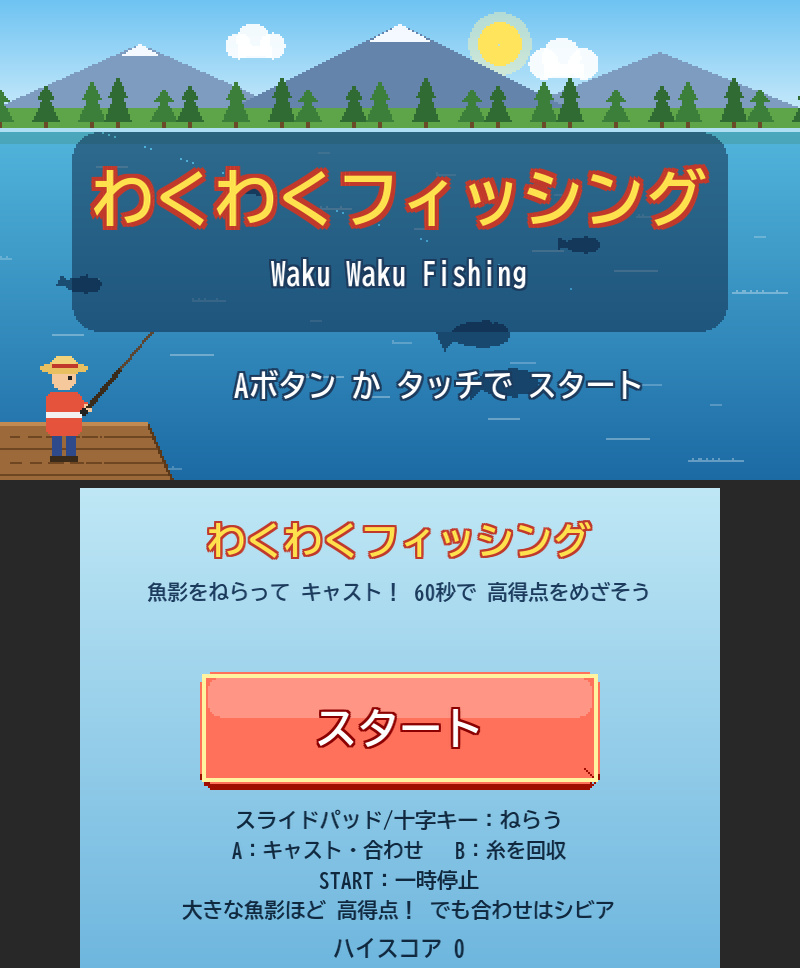
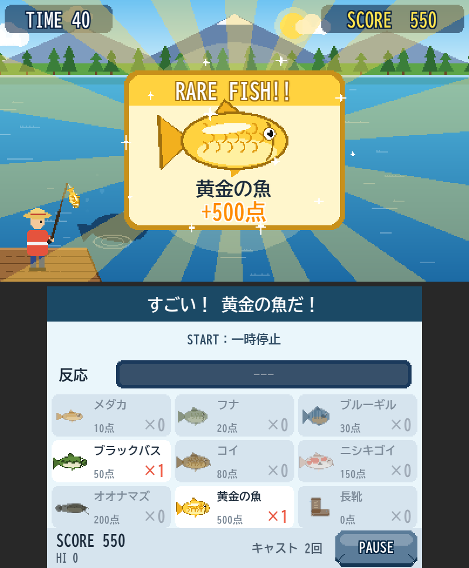
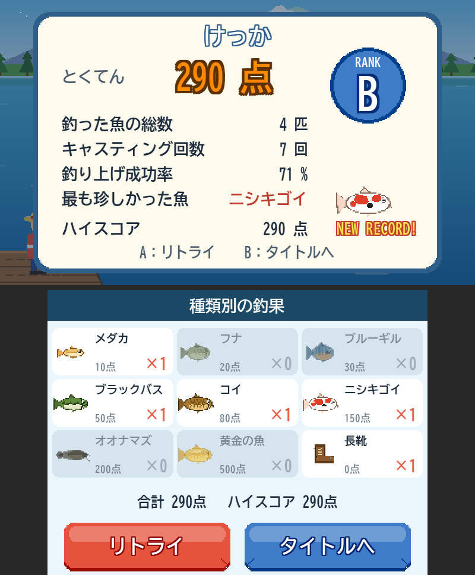

# わくわくフィッシング3DS（Waku Waku Fishing）

初代 Nintendo 3DS 向けの自作 2D 釣りゲームです（Homebrew Launcher で起動する `.3dsx`）。
湖を泳ぐ魚影を見つけて狙った位置にウキを投げ、魚が食いついた瞬間に A ボタンで合わせ、糸の張りを保ちながら巻き上げます。
制限時間 60 秒で、できるだけ高い得点を目指します。

| タイトル | 狙う | HIT! | やりとり | 黄金の魚 | 結果 |
|---|---|---|---|---|---|
|  |  |  |  |  |  |

※ 画像は PC 上のプレビューツール（`tools/preview`）で描画コードを動かして作ったものです。文字は PC のフォントで代用しているため、実機とは字形が少し異なります。

- 言語：C（C99）
- 開発環境：devkitPro / devkitARM、libctru、citro2d / citro3d
- 対象：初代 Nintendo 3DS（New 3DS 専用機能は不使用）、立体視なし、通信なし
- 外部素材なし（絵はすべて図形描画、効果音はプログラムで合成）

---

## 1. 遊び方

1. タイトル画面で **A ボタン** または下画面の **「スタート」** をタッチ
2. **スライドパッド / 十字キー左右** で黄色い照準（着水予定位置）を動かす
3. 魚影の **少し横**（5〜30px。照準の左右に出る白い目盛りが目安）に合わせて **A** でキャスト
   - 魚影の真上（5px 未満）に落とすと魚は驚いて逃げる
   - 遠すぎる（30px 超）と反応しない
4. 魚がウキに寄ってきて、しばらくすると食いつく（この間に A を押すと「早すぎた！」で失敗）
   - **フェイントに注意**：本物の食いつきの前に、ウキが一瞬だけ沈むことがある。見た目は本物そっくりだが「HIT!」は出ない。ここで A を押すと「フェイントだった！」で失敗
   - フェイントの回数はレアな魚ほど多い（メダカ 0〜1 回 … 黄金の魚 2〜4 回）
5. ウキが沈んで **「HIT!」** が出たら、すぐに **A**！
   - 入力猶予：小 0.85 秒 / 中 0.7 秒 / 大 0.55 秒（下画面の反応ゲージで残り時間が分かる）
6. 合わせに成功すると **「やりとり」**。上画面中央（と下画面）の **テンションメーター** を見ながら釣り上げる
   - **A を押している間** 糸を巻く（張りが強くなり、巻き上げが進む）。**離すと** 張りがゆるむ
   - 張りが赤い所の右端まで行くと **糸が切れる**。青い所で 0 のまま 0.6 秒たつと **針が外れる**
   - 魚の上に **「！」** が出たら暴れる合図。暴れている間は巻けず、巻くと張りが一気に上がるので **A を離す**
   - 黄色いバー（巻き上げ）が満タンになったら釣り上げ成功
7. 60 秒経つと結果画面。ランク（D〜S）とハイスコアが表示される

大きな魚影ほど高得点の魚（ニシキゴイ、オオナマズ、黄金の魚…）が期待できますが、合わせはシビアで、やりとりも手ごわくなります。

### やりとりの強さ（レアな魚ほど手ごわい）

| 魚種 | 巻き上げ | 暴れ | 予兆（「！」）の長さ | 上手な人の目安時間 |
|---|---|---|---|---:|
| メダカ | とても速い | 暴れない（押しっぱなしで釣れる） | － | 約1秒 |
| フナ / ブルーギル | 速い | 弱い | 0.5 / 0.45 秒 | 約2秒 |
| ブラックバス / コイ | ふつう | ふつう | 0.4 / 0.36 秒 | 約3〜4秒 |
| ニシキゴイ | やや遅い | 強い | 0.33 秒 | 約5秒 |
| オオナマズ | 遅い | とても強い | 0.30 秒 | 約6秒 |
| 黄金の魚 | とても遅い | 激しい・頻繁 | 0.27 秒 | 約10秒 |
| 長靴 | 重いだけ | 暴れない | － | 約2秒 |

やりとり中も制限時間は減るので、大物ほど時間もかかります。

### 操作一覧

| 操作 | 内容 |
|---|---|
| スライドパッド左右 / 十字キー左右 | 着水予定位置の移動 |
| A | 開始・キャスト・合わせ・リトライ |
| A 長押し | やりとり中に糸を巻く（離すとゆるむ） |
| B | 釣り糸を回収（キャンセル）／結果画面でタイトルへ |
| START | 一時停止メニュー（ゲームに戻る／タイトルに戻る／ゲームを終了する） |
| 十字キー上下 | 一時停止メニューの選択 |
| タッチ | スタート・PAUSE・メニュー・リトライ・タイトルへ |

「ゲームを終了する」を選ぶと Homebrew Launcher に戻ります。

### 魚と得点

| 魚種 | 得点 | 小 | 中 | 大 |
|---|---:|---:|---:|---:|
| メダカ | 10 | 45% | 0% | 0% |
| フナ | 20 | 30% | 15% | 0% |
| ブルーギル | 30 | 20% | 25% | 0% |
| ブラックバス | 50 | 0% | 35% | 15% |
| コイ | 80 | 0% | 20% | 35% |
| ニシキゴイ | 150 | 0% | 0% | 25% |
| オオナマズ | 200 | 0% | 0% | 19% |
| 黄金の魚 | 500 | 0% | 0% | 1% |
| 長靴 | 0 | 5% | 5% | 5% |

魚影サイズの出現率：小 50% / 中 35% / 大 15%。ランク：D 0〜99、C 100〜249、B 250〜499、A 500〜799、S 800〜。

---

## 2. フォルダ構成

```
fishing3ds/
├── Makefile              3DS 用ビルド設定（devkitARM）
├── icon.png              Homebrew Launcher 用アイコン（tools/make_icon.py で生成）
├── fishing.3dsx          ← ビルド成果物（git 管理外）
├── source/
│   ├── game.h / game.c   ゲームロジック（3DS 非依存。調整用の定数は game.h、やりとりの強さは game.c の FIGHT_PARAMS）
│   ├── main.c            入力・描画・効果音・エフェクト・メインループ
│   ├── art.h / art.c     魚種ごとのカラーイラスト（図形描画）
│   ├── draw.h / draw.c   citro2d 上の簡易描画レイヤー（図形・文字）
│   └── audio.h / audio.c 簡易シンセ（ndsp）
├── tests/
│   ├── test_game.c       ゲームロジックの自動テスト（PC 上で実行）
│   └── Makefile
├── tools/
│   ├── make_icon.py      アイコン生成（Pillow が必要）
│   └── preview/          PC 用の画面プレビュー（描画コードを PC で動かして PNG 化）
└── docs/
    ├── TEST_REPORT.md        テスト結果
    ├── DEVICE_CHECKLIST.md   実機確認用チェックリスト（テスト手順書）
    └── images/               スクリーンショット（プレビュー）
```

ゲームロジック（`game.c`）と描画（`main.c` / `art.c`）は分離しています。`game.c` は libctru に依存しないため、PC の gcc でそのままテストできます。

---

## 3. 開発環境構築手順

devkitPro 公式の手順（<https://devkitpro.org/wiki/Getting_Started>）に従って **3ds-dev** を入れます。

### 3.1 推奨：WSL（Ubuntu）上に構築する

この PC では、Windows 11 の「スマート アプリ コントロール」が MSYS2 版 devkitPro のコンパイラ（`arm-none-eabi-gcc.exe`）をブロックするため、**WSL の Ubuntu** でビルドしています。

1. PowerShell で WSL と Ubuntu を入れる（未導入の場合）
   ```powershell
   wsl --install -d Ubuntu
   ```
2. Ubuntu で devkitPro pacman を導入する（公式手順。インストーラは <https://devkitpro.org/wiki/devkitPro_pacman> を参照）
   - devkitPro のサーバーは `curl` / `wget` からのアクセスを 403 で拒否することがあります。その場合はブラウザで取得するか、公式 wiki の apt リポジトリ方式を使ってください（署名鍵 `C9D672AF4128A2F1` は keyserver.ubuntu.com から取得できます）。
3. 3DS 開発一式を入れる
   ```bash
   sudo dkp-pacman -S 3ds-dev
   ```
4. 環境変数を読み込む（`DEVKITPRO` / `DEVKITARM` が設定される）
   ```bash
   source /etc/profile.d/devkit-env.sh
   echo $DEVKITARM   # /opt/devkitpro/devkitARM と表示されれば OK
   ```
5. 自動テスト用に PC 向け gcc も入れる
   ```bash
   sudo apt-get install -y gcc make
   ```

### 3.2 Windows に直接入れる場合

devkitPro の Windows インストーラ（<https://github.com/devkitPro/installer/releases>）で **3DS Development** を選んでインストールし、「devkitPro → MSYS2」から `make` を実行します。スマート アプリ コントロールが有効だとコンパイラが起動しないことがあります。

---

## 4. ビルド手順

### 3DS 用（fishing.3dsx）

WSL の Ubuntu で：

```bash
source /etc/profile.d/devkit-env.sh
cd /mnt/c/mycode/mochiusagi/fishing3ds
make            # fishing.3dsx / fishing.smdh / fishing.elf ができる
make clean      # 生成物の削除
```

Windows の PowerShell から 1 行で実行する場合：

```powershell
wsl -d Ubuntu -u root -- bash -c "source /etc/profile.d/devkit-env.sh && cd /mnt/c/mycode/mochiusagi/fishing3ds && make"
```

### 自動テスト（PC）

```bash
cd /mnt/c/mycode/mochiusagi/fishing3ds
make -C tests        # ビルドして実行。最後に PASS / FAIL の件数を表示
```

### 画面プレビュー（任意・PC）

```bash
cd tools/preview && mkdir -p out
gcc -std=gnu99 -O2 -Ifake -I../../source -o preview preview.c ../../source/draw.c ../../source/art.c ../../source/game.c -lm
./preview                       # out/ に各場面の PPM とテキスト一覧を出力
python compose.py out           # PNG に合成（Windows 側の Python + Pillow。日本語フォントは BIZ UDゴシック）
```

---

## 5. SD カードへの配置手順

既存のファイルは削除・上書きしないでください。`/3ds/fishing/` フォルダが既にある場合は、中身を確認してから進めてください。

1. 3DS の電源を切り、SD カードを PC に挿す
2. SD カードの `3ds` フォルダの中に `fishing` フォルダを作る
3. `fishing.3dsx` をコピーする

```
SD:/
└── 3ds/
    └── fishing/
        └── fishing.3dsx
```

（`fishing.smdh` はコピー不要です。アイコンと名前は `.3dsx` に埋め込まれています）

### 効果音について

効果音を鳴らすには、SD カードに `/3ds/dspfirm.cdc` が必要です（自分の本体から DSP1 などのツールで吸い出したもの）。
無い場合でもゲームは**無音で正常に動作**します。

---

## 6. 実機起動手順

1. SD カードを 3DS に戻して電源を入れる
2. Homebrew Launcher を起動する（環境により、HOME メニューの Homebrew Launcher アイコン、または Rosalina メニューの「Homebrew」などから）
3. 一覧から **「Waku Waku Fishing」**（魚とウキのアイコン）を選んで A
4. 終了するときは START →「ゲームを終了する」→ Homebrew Launcher に戻る

実機での確認項目は [docs/DEVICE_CHECKLIST.md](docs/DEVICE_CHECKLIST.md) を参照してください。

---

## 7. 調整用の定数

難易度・得点・出現率などはすべて `source/game.h` / `source/game.c` の先頭にまとめています。

| 定数 | 既定値 | 内容 |
|---|---|---|
| `GAME_TIME_SEC` | 60 | 制限時間（秒） |
| `TIME_WARN_SEC` | 10 | タイマーを赤くする残り秒数 |
| `NEAR_MIN` / `NEAR_MAX` | 5 / 30 | キャスト判定距離（px） |
| `CAST_TIME` | 0.4 | キャスティング時間（秒） |
| `BITE_WAIT_MIN` / `MAX` | 0.5 / 2.0 | 食いつきまでの時間（秒） |
| `SIZE_GRACE[]` | 0.85 / 0.7 / 0.55 | 合わせの入力猶予（小/中/大）。仕様書の 1.2 / 1.0 / 0.8 から短縮 |
| `SIZE_SPEED[]` | 42 / 28 / 17 | 魚影の遊泳速度（px/秒） |
| `SIZE_SPAWN_PCT[]` / `SPECIES_PCT[][]` | 仕様書どおり | 出現率 |
| `SPECIES_POINTS[]` | 仕様書どおり | 得点 |
| `RANK_MIN_SCORE[]` | 100/250/500/800 | ランク C/B/A/S の最低点 |
| `MISS_SHOW_TIME` | 0.7 | 失敗後にキャスト可能になるまで |
| `CATCH_SHOW_TIME` / `GOLD_SHOW_TIME` | 1.0 / 1.6 | 釣果表示の時間 |
| `RESPAWN_MIN` / `MAX` | 1 / 3 | 釣った後に新しい魚影が出るまで |
| `FEINT_MIN_COUNT[]` / `FEINT_MAX_COUNT[]`（game.c） | 魚種ごと | フェイントの回数（メダカ0〜1、フナ0〜1、ギル0〜2、バス1〜2、コイ1〜2、ニシキ1〜3、ナマズ2〜3、黄金2〜4、長靴0〜1） |
| `FEINT_TIME` | 0.3 | フェイントでウキが沈んでいる時間 |
| `FEINT_GAP_MIN` / `MAX` | 0.3 / 0.8 | フェイントの前の待ち時間 |
| `FEINT_AFTER_MIN` / `MAX` | 0.3 / 1.0 | 最後のフェイントから本物の食いつきまで |
| `FIGHT_PARAMS[]`（game.c） | 魚種ごと | やりとりの強さ：巻き上げ速度・常にかかる引き・暴れの強さ・暴れる間隔・暴れる時間・予兆の長さ |
| `FIGHT_START_TENSION` | 0.35 | やりとり開始時のテンション |
| `REEL_TENSION_UP` / `RELEASE_TENSION_DOWN` | 0.55 / 0.75 | 巻く／離すときのテンション変化（/秒） |
| `RUSH_PULL_RELEASED` | 0.6 | 離していても暴れの引きが効く割合 |
| `RUSH_LINE_DRAIN` | 0.06 | 暴れている間に引き出される糸（巻き上げ/秒） |
| `SLACK_LIMIT` | 0.6 | テンション0がこの秒数続くと針が外れる |

---

## 8. 実装上の判断（仕様書に明記のない点）

初代 3DS での安定動作と遊びやすさを優先して、次のように決めました。

1. **近すぎる魚と興味を持つ魚が同時にいる場合**：近すぎた（5px 未満）魚は逃げ、5〜30px の魚がいればそのうち最も近い 1 匹が反応する。反応する魚がいなければ失敗（近すぎ）。
2. **距離ちょうど 5px と 30px** はどちらも「興味を持つ」に含める。
3. **キャスト中（0.4 秒）の A / B は無視**する（連打で即失敗にならないように）。
4. **B ボタン**：魚が寄ってくる間・食いつき待ちの間は「糸の回収」（失敗扱いにしない）。HIT 中の B は合わせ失敗。
5. **長靴**：0 点。「釣り上げ成功率」には成功として数えるが、「釣った魚の総数」には含めない。
6. **釣り上げ成功率** = 釣り上げ成功回数 ÷ キャスティング回数（四捨五入）。
7. **結果画面**は時間切れ直後 1.2 秒間「TIME UP!」を表示し、その間は入力を受け付けない（合わせの A 連打でうっかりリトライしないように）。
8. **魚影の Y 座標**：5 本のレーン（Y=96, 120, 144, 168, 192 ±3px）に 1 匹ずつ配置し、重ならないようにした。
9. **照準の左右に ±30px の目盛り**を表示して、「魚影の少し横に投げる」ことを分かりやすくした。
10. **時間の計測**は実経過時間（`osGetTime`）。HOME メニューやスリープからの復帰で時間が飛ばないよう、1 フレームの経過時間は最大 0.05 秒に制限。
11. **黄金の魚の釣果表示**は特別演出のため 1.6 秒（通常は 1.0 秒）。
12. 表示は日本語（3DS 本体の内蔵フォントを使用）。
13. ハイスコアはアプリ起動中のみ保持（SD カードには保存しない）。
14. **やりとり（追加仕様）**：合わせ成功後に状態 `FIGHT` を追加。釣果（得点・釣果数・成功回数）はやりとりで巻き上げきった時点で確定する。やりとり中に時間切れになった魚は得点に含めない。
15. やりとりは A の長押しを使う唯一の操作。それ以外（キャスト・合わせ・メニュー）は従来どおり「押した瞬間」だけ反応する。
16. 照準の操作は仕様書 7.1 のとおり左右のみ（着水点の Y 座標は固定）。
17. **合わせの入力猶予**は、ユーザー要望により仕様書 8.2 の 1.2 / 1.0 / 0.8 秒から 0.85 / 0.7 / 0.55 秒（小/中/大）に短縮。
18. **フェイント（追加仕様）**：食いつき待ちの間に、ウキが本物の食いつきと同じように沈む（しぶき・音・魚影の震えも同じ）が「HIT!」は出ない。フェイント中の A は失敗（`MISS_FEINT`）、フェイント以外の待ち中の A は従来どおり「早すぎた」。フェイントが無い場合の食いつき待ちは仕様どおり 0.5〜2 秒、フェイントがある場合はその分長くなる。
